# MENTAL BREAKDOWN

**Equipo de desarrollo: Qingtian Games**

* CHEN, ZIMIN

* LADRÓN DE GUEVARA JIMÉNEZ, JORGE-GINÉS

* OLTEAN, GABRIEL ADRIAN

* SÁNCHEZ LÓPEZ, TRISTÁN

## Índice

- [1. Descripción general](#1-descripción-general)
  - [1.1 Concepto](#11-concepto)
  - [1.2 Género](#12-género)
  - [1.3 Setting](#13-setting)
  - [1.4 Características principales](#14-características-principales)
- [2. Gameplay](#2-gameplay)
  - [2.1 Objetivo del juego](#21-objetivo-del-juego)
  - [2.2 Core loops](#22-core-loops)
- [3. Personaje jugador](#3-personaje-jugador)
  - [3.1 Controles](#31-controles)
  - [3.2 Sprite del jugador](#32-sprite-del-jugador)
- [4. Mecánicas](#4-mecánicas)
  - [4.1 Barra locura](#41-barra-locura)
  - [4.2 Barra de energía (prioridad)](#42-barra-de-energía-prioridad)
  - [4.3 Exploración de mazmorras](#43-exploración-de-mazmorras)
  - [4.4 Elección en las salas](#44-elección-en-las-salas)
  - [4.5 Cultivo de emociones](#45-cultivo-de-emociones)
  - [4.6 Mejoras de personajes](#46-mejoras-de-personajes)
  - [4.7 Ataques](#47-ataques)
  - [4.8 Definitivas](#48-definitivas)
  - [4.9 Habilidades](#49-habilidades)
  - [4.10 Debilidades](#410-debilidades)
    - [4.10.1 Debilidad en emociones](#4101-debilidad-en-emociones)
  - [4.11 Organización/gestión de equipo](#411-organizacióngestión-de-equipo)
- [5. Mundo del juego](#5-mundo-del-juego)
  - [5.1 Personajes](#51-personajes)
  - [5.2 Enemigos](#52-enemigos)
  - [5.3 Bosses](#53-bosses)
  - [5.4 Obstáculos](#54-obstáculos)
  - [5.5 Objetos](#55-objetos)
  - [5.6 Niveles](#56-niveles)
- [6. Interfaz](#6-interfaz)
  - [6.1 Cámara](#61-cámara)
  - [6.2 HUD Menús](#62-hud-menús)
- [7. Experiencia de Juego](#7-experiencia-de-juego)
  - [7.1 Trasfondo](#71-trasfondo)
  - [7.2 Historia](#72-historia)
- [8. Dinámicas](#8-dinámicas)
- [9. Estética](#9-estética)
  - [9.1 Arte](#91-arte)
  - [9.2 Sonido](#92-sonido)
- [10. Referencias](#10-referencias)

# 1. Descripción general

## 1.1 Concepto

En el juego hay varias emociones que componen los personajes jugables. Cada emoción tiene diferentes ataques y efectos. Cada una contará con un ataque básico, una habilidad básica y una definitiva.

El objetivo es derrotar a los enemigos usando las diferentes emociones. Los enemigos son los demonios internos que el personaje tiene dentro de su cabeza, que lucha contra sus otras personalidades y pensamientos.

La elección de las emociones ocurre antes de comenzar el combate. Pueden cambiarse en cualquier momento del combate, pero no podrán efectuar ninguna acción durante el turno en el que entren. Al morir una emoción, el jugador podrá elegir la que va a sacar para sustituirla.

Tras los combates, investigaremos distintas partes de nuestro cerebro y podremos encontrar diferentes salas. Entre ellas está la del sistema límbico (donde se originan las emociones), en la que podremos cultivar distintas emociones. Al cultivar, se nos pedirá cumplir un requisito para que esa emoción gane fuerza; al completarlo, se mejorará el personaje elegido.

Durante los combates el jugador presentará una barra de locura que irá aumentando y decreciendo durante el transcurso de la partida, por usar habilidades y/o por decisiones en la exploración de mazmorras. Esta barra de locura tendrá efecto tanto dentro como fuera de los combates.

## 1.2 Género

Exploración de mazmorras y combate por turnos. Estrategia y toma de decisiones. Roguelike clicker.

## 1.3 Setting

Eustaquio es un esclavo de sus pensamientos, que le comen la cabeza constantemente, lo que últimamente le está volviendo loco. Nos adentramos en su cerebro para averiguar cómo solucionar esto. Controlando las emociones de Eustaquio intentaremos sacar sus demonios afuera y devolverle a su estable origen. Dentro de su cerebro no seremos bienvenidos: al contrario, deberemos enfrentar a múltiples enemigos y combatir con su locura para intentar que no sea consumido a sí mismo.

## 1.4 Características principales

El juego se resume en una exploración de mazmorras en la que viajas por la mente de Eustaquio controlando sus emociones. Se combate contra enemigos que representan enfermedades mentales.

Los combates son por turnos al estilo RPG. El orden de los ataques estará determinado por la prioridad de cada personaje (a más prioridad, antes ataca).

Durante la exploración de mazmorras nos adentraremos dentro de un mundo generado proceduralmente: en este encontraremos diferentes salas que nos podrán proporcionar objetos o salas que nos permitirán ganar mejoras. Podremos encontrarnos con diversos jefes a medida que avanzamos. Con ellos ganaremos grandes mejoras.

# 2. Gameplay

## 2.1 Objetivo del juego

Se pierde cuando todas las emociones del equipo llegan a 0 de vida o cuando la barra de locura llega al máximo.

Para ganar, el jugador deberá avanzar por las distintas salas ganando sus combates y realizando otras tareas de exploración y mejora de personajes (cultivar, derrotar a todos los enemigos/boss o sobrevivir).

Al vencer al boss final, el juego terminará y el jugador habrá ganado.

Al morir en cualquier punto del juego, la partida se reiniciará y el jugador habrá perdido.

## 2.2 Core loops

El bucle principal se basa en entrar aleatoriamente en salas, explorar, recoger objetos y tomar decisiones. Al llegar a una sala de preparación, sabremos que la siguiente será de combate. Todo esto se repite en bucle. 

Entre las salas se encuentra la del sistema límbico, en la que podemos gastar frascos para mejorar a nuestros personajes. Cada cierto número de combates entraremos a una sala de jefe. Tanto los combates como los jefes proporcionan frascos que se pueden usar para mejorar a los personajes. La partida termina al morir o tras derrotar a todos los jefes.

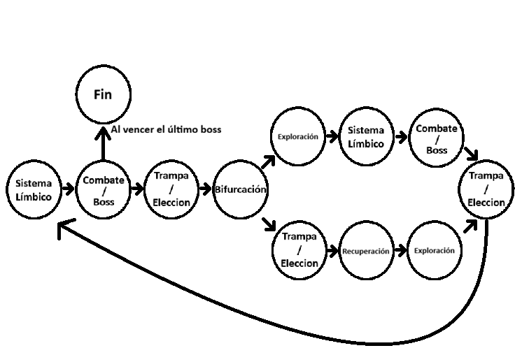

# 3. Personaje jugador

## 3.1 Controles

| Acción | Tecla |
| :---: | :---: |
| Interactuar con menús/ todo | Click Ratón Izq |
| Navegación por menús (En Teclado) | Flechas |

## 3.2 Sprite del jugador

# 4. Mecánicas

## 4.1 Barra locura

Durante los combates, existirá una barra de locura. Está comenzará vacía y, cada vez que se use una habilidad subirá en función del grado de dicha habilidad. Si la barra llega al máximo, los personajes se vuelven locos y se perderá la partida. A medida que suba la barra, aumentará la probabilidad de que las emociones se ataquen entre sí. También puede ser afectada por decisiones durante la exploración de mazmorras.

| Parámetro | Descripción | Unidades |
| :---: | :---: | :---: |
| Locura total | Nivel máximo de locura que se puede alcanzar | u |

## 4.2 Barra de energía(prioridad)

En los combates se lucha mediante prioridad, que es una estadística concreta de cada personaje. Cuanto mayor sea este número antes se realizará el ataque. La prioridad puede verse afectada por acciones durante el combate o por decisiones durante la exploración.

## 4.3 Exploración de mazmorras

El jugador avanza con su equipo por las distintas salas de la mente, explorando y obteniendo beneficios para sus personajes. En las salas, además de tomar decisiones, también podemos recoger objetos que otorgan otros beneficios.

## 4.4 Elección en las salas

El jugador entra en una sala y puede elegir entre diferentes opciones dentro de esta. Se presentan distintos caminos por los que se puede viajar, y dependiendo del estilo de juego que tengamos elegiremos uno u otro.

Tras elegir y pasar a la siguiente sala, ya no se podrá volver atrás.

## 4.5 Cultivo de emociones

El cultivo de emociones se produce en las salas del sistema límbico. Al entrar en esta sala, podremos usar los frascos de emociones que hayamos recogido durante el camino. Para cultivar emociones, elegimos una emoción que queremos potenciar y consumimos un frasco de emoción. Existen tres tipos de frascos: los permanentes, que necesitan una pequeña condición para activar la mejora, pero trascienden a través de las distintas partidas; los de un uso, que requieren una condición más sencilla, pero solo están activos durante la misma partida; y los temporales, que mejoran al personaje elegido hasta que termine el siguiente combate, sin ningún requisito.

Cada vez que el jugador cultiva una emoción, puede elegir entre varias mejoras (generalmente dos, salvo que se encuentre en un estado de desequilibrio o locura). Estas beneficiarán a la emoción protagonista de la sala, desequilibrando la balanza a su favor.

Una de estas mejoras siempre será un ligero modificador positivo a cualquiera de los ataques/ habilidades y atributos básicos de la emoción (+daño, prioridad, etc.)

La otra añadirá algún efecto a una de las funciones de esa emoción (por ejemplo, aplicar una nueva desventaja a los enemigos o modificar la barra de locura).

Si aceptar esta mejora supone un gran desequilibrio emocional (x mejoras por encima del resto, o 2 por encima de las otras 2, o 3 por encima de la última, etc.); se podrá escoger una tercera mejora, generalmente con más impacto, cambiando el estilo de juego de la run actual (si Alegría y Tristeza están combatiendo, reciben un 30% de daño extra, si no, todas reciben un \-10%; cada 3 enemigos eliminados por ira, obtén un frasco para cultivar, etc.).

## 4.6 Mejoras de personajes

* **Miedo:**
  * Las cargas de valentía reducen el fallo en un 33%
  * Al acertar con valentía haces un 10% más de daño
  * Si fallas con 1 carga de valentía tu próximo ataque hace un 50% más de daño
  * El enemigo que esté en el centro del radio de daño recibe un 50% más de daño?
  * Cada 2 usos de la definitiva (aplica para el próximo), en caso de que se ejecute sin 2 cargas de valentía, recibe 3 (acumulables hasta 4\)

**Mejora fuerte:** al principio de cada combate, Miedo puede asignar a una emoción (que no sea el) la propiedad de, automáticamente, infundir miedo a un tipo de enemigo. Esto causa que, mientras dicha emoción esté en combate, este tipo de enemigo actuará siempre último y hará un 15% menos de daño.

Sin embargo, si la emoción asignada muere, estos enemigos siempre actuarán primero (hasta el final del combate), haciendo también un 15% más de daño.

* **Tristeza:**
  * Los enemigos con depresión hacen un 5% menos de daño y reciben un 5% más
  * Los enemigos pueden stackear hasta 4 turnos de **depresión**
  * (Si se cambia la mecánica actual) Cada vez que se aplica la depresión a un enemigo, se le suman 2 turnos en vez de 1 (el máximo por defecto sigue siendo 3\)
  * El enemigo que esté en el centro del radio de daño recibe un 50% más de daño
  * Cada 2 definitivas, se aplica en daño en área del ataque básico a aquellos enemigos que ya tengan **depresión**

**Mejora fuerte:** Desde el principio del combate, Tristeza puede elegir a **un enemigo** que no tenga **depresión** y le asigna una bomba (**depresión severa**), y tiene un 50% de probabilidades de aplicarle **depresión** permanentemente. Si al cabo de 2 turnos, dicho enemigo y los 2 de sus lados (es decir, solo los más cercanos) tienen **depresión**, dicho enemigo abandona el campo y cualquier otro que se ponga en su posición lo hará también, automáticamente.

Además, cuando este primer asignado abandone, se le asigna una bomba a los 2 de los lados, con el mismo funcionamiento pero teniendo que esperar 1 turno más hasta explotar.

Sin embargo, si la primera bomba falla, todos los enemigos que tuviesen **depresión** se la quitan, y se curan el daño que les haría un ataque básico de depresión. Lo mismo aplica para el resto de bombas, pero sin la cura de vida.

* **Alegría:**
  * Cura un 15% más a sus aliados y un 10% a sí mismo, que se alterna cada turno
  * Puede curar a 2 aliados
  * La mitad de la vida que cura es devuelta como daño al enemigo que esté frente al aliado curado
  * Aplica daño en área
  * Cada 2 definitivas, puede volver a hacer una acción en ese mismo turno
  * La habilidad, además de curar tiene opción de boostear el daño del aliado en un 10% durante los próximos 2 turnos

**Mejora fuerte:**  Una vez por combate, desde el principio, Alegría puede revivir a un aliado caído (menos ella misma); dejándolo al 50% de su vida total. Sin embargo, cada enemigo caído tiene una probabilidad del 20% de revivir (también al 50% de su vida).

* **Ira:**
* La **invocación** hace un 7% más de daño por cada turno que lleve en combate
* El rango de daño en área se incrementa de 3 enemigos a 5
* La invocación puede atacar a cualquier enemigo a rango del ataque básico de ira (en vez de atacar al mismo enemigo que la emoción a la que apoya)
* Los enemigos que estén en los bordes del radio de ataque, reciben un 50% más de daño
* Cada 2 definitivas, la prolongación de turnos de la **invocación** cambia de establecerse en 5 a sumar 5\. Además, el próximo ataque de esta **invocación** hace daño a **TODOS** los enemigos y cura a la emoción aliada en un 10% del daño infligido

**Mejora fuerte:**: Ira entra en modo raid boss durante 4 turnos, creciendo en tamaño.

Gana un 50% de vida máxima (que se le suma a la actual), un 20% de daño y amplía en 1 su rango de ataques en área. Sin embargo, pierde 2 de prioridad (ya que es algo más lento).

Además, cuando se acabe el efecto, recibe los mismos modificadores solo que opuestos y a la mitad, durante 2 turnos.

Mejora común de LOCURA: este personaje afecta a la barra de locura un 20% más (Max 2 personajes). 10% de aparecer.

(En función de los enemigos que dejemos y los que pongamos pues se pueden meter mejoras que interactúen con sus mecánicas, pero por ahora lo ignoro hasta que sepamos q enemigos vamos a tener exactamente)

**Mejoras compartidas:**

**Nostalgia:** cuando alegría y tristeza están en el campo de batalla, hacen un 15% más de daño, y se ven afectados un 15% por los modificadores enemigos negativos.

Le ocurre lo contrario a todas las emociones cuando no están las 2 en el campo.

**Paranoia:** cuando miedo e ira están en el campo de batalla y reciben el castigo de la barra de locura, estas atacan a **TODOS** los demás personajes que estén activos en combate, no solo se atacan entre ellos. Sin embargo, reciben el doble de daño de los ataques de su compañero.

**Mejora fuerte para TODOS**: cuando están 3 frascos o más por debajo de todos esta mejora desaparece y no puede volver a aparecer cuando se reduce de 9 (con mínimo 3 cada una) la diferencia de frascos que tienen las otras 3 emociones con la que posee la mejora: por cada 3 frascos de diferencia con el resto, esta mejora ve incrementados todos sus bonificadores positivos en un 7%. Sin embargo, también hace 5% daño extra (al que se le suma el 7% por stack) a sus aliados durante las rondas de locura.

Al llegar a 6 acumulaciones (18 frascos), la locura comienza a afectar también a los enemigos.

| Parámetro | Descripción | Unidades |
| :---: | :---: | :---: |
| Máximo mejora | El número máximo de mejoras que puede tener un personaje | u |
| Beneficio | El porcentaje de mejora al personaje que sea aplicado | % |
| Permanencia | Pueden ser o no permanentes para el personaje | Si/No |
| Máximo mejora por sala | El número máximo de mejoras que se pueden gastar en una sala( puede variar) | u |

## 4.7 Ataques

El ataque básico es una de las acciones que se pueden realizar durante el combate. Es el ataque que realiza la emoción de forma habitual. Por tanto no tiene cooldown y es usable una vez por turno.

| Parámetro | Descripción | Unidades |
| :---: | :---: | :---: |
| Daño | El daño que recibe el enemigo | u |

## 4.8 Definitivas

La definitiva es una de las acciones que se pueden realizar durante el combate. Se carga tras varios ataques. Genera un ataque más poderoso de lo normal y puede añadir un beneficio a los aliados o una debilidad al rival.

| Parámetro | Descripción | Unidades |
| :---: | :---: | :---: |
| Daño | El daño que recibe el enemigo | u |
| Carga | El número de ataques necesarios para poder usarla | u |

## 4.9 Habilidades

La habilidad es una de las acciones que se pueden realizar durante el combate. Consiste en gastar un turno para obtener un beneficio. Tras usarla, deberemos esperar un número determinado de turnos para poder volver a utilizarla.

| Parámetro | Descripción | Unidades |
| :---: | :---: | :---: |
| Beneficio | El beneficio que recibe el personaje | u |
| Cooldown | Turnos necesarios para que pueda volver a ser usado | u |

## 4.10 Debilidades

Para usar más eficientemente los ataques de nuestros personajes podemos usar las debilidades esto se mostrará en el ataque si estamos atacando a un enemigo que nos tiene debilidad. Y el daño se multiplica x1,5. Esta es la tabla de debilidades para ambos lados pueden ser usados por el jugador para hacer más daño y evitar recibir tanto daño

### 4.10.1 Debilidad en emociones

|  | Bipolaridad | Psicosis | Anorexia | Estrés | Esquizofrenia | TOC |
| :---: | :---: | :---: | :---: | :---: | :---: | :---: |
| Miedo | 1,5 | 1 | 1,5 | 1,5 | 1 | 1 |
| Tristeza | 1 | 1,5 | 1 | 1,5 | 1 | 1,5 |
| Alegría | 1,5 | 1 | 1,5 | 1 | 1,5 | 1 |
| Ira | 1 | 1,5 | 1 | 1 | 1,5 | 1,5 |

**Debilidad en enemigos**

|  | Miedo | Tristeza | Alegría | Ira |
| :---: | :---: | :---: | :---: | :---: |
| Miedo | 1 | 1 | 1,5 | 1 |
| Tristeza | 1 | 1 | 1 | 1.5 |
| Alegría | 1 | 1,5 | 1 | 1 |
| Ira | 1,5 | 1 | 1 | 1 |
| Bipolaridad | 1 | 1,5 | 1 | 1,5 |
| Psicosis | 1 | 1 | 1,5 | 1 |
| Anorexia | 1,5 | 1 | 1 | 1 |
| Estrés | 1 | 1 | 1,5 | 1,5 |
| Esquizofrenia | 1,5 | 1 | 1 | 1 |
| TOC | 1 | 1,5 | 1 | 1 |

## 4.11 Organización/gestión de equipo

Antes de empezar cada combate, podremos elegir los personajes con los que comenzaremos. Durante nuestro turno, tendremos un botón para cambiar de personajes. Desde ahí podremos visualizar las estadísticas y los movimientos de nuestro equipo, así como cambiar los personajes que deseemos. Sin embargo, los que entren al combate no podrán atacar en su turno de entrada. Explicado en la navegación por menús.

# 5. Mundo del juego

## 5.1 Personajes

Los personajes tendrán 1 ataque básico, 1 habilidad, 1 definitiva y 1 pasiva(por decidir) durante el juego. La definitiva se carga cuando los aliados reciben daño o usan habilidades.

Al iniciar una partida comenzaremos con Alegría y podemos ir encontrando a las otras emociones a medida que avanzamos. A medida que vayamos encontrando a las demás, podremos incluirlas en nuestro equipo para tener distintas habilidades. Si tenemos más de tres emociones, solo podremos usar dos al mismo tiempo; la otra será intercambiable gastando un turno.

1. ### **Miedo**

* Personaje principal con el que empezará el jugador.

* **Ataque básico:** Tiene un 50% de probabilidades de fallar el ataque y un 50% de probabilidades de ejecutar un ataque en área. Si el personaje tiene cargas de ?**valentía**? se gasta 1 carga cada vez. (Baja la barra de ?**locura**?)

* **Habilidad:** Gasta un turno para ganar 1 carga de ?**valentía**? hasta un máximo de 2 cargas. Cada carga de ?**valentía**? baja las probabilidades de fallar el ataque básico un 25% y aumenta el daño infligido de esta. (Sube la barra de ?locura?)

* **Definitiva:** Si tiene 2 cargas de ?**valentía**? ejecuta un ataque en área que aplica aturdimiento durante 2 turnos a los enemigos. En caso contrario sus cargas de ?**valentía**? aumentan hasta 2 y ejecuta un ataque básico con 100% de probabilidades de acertar.  (Sube la barra de ?**locura**?)

  2. ### **Tristeza**

* **Ataque básico:** Inflige daño a un enemigo, si el enemigo tiene ?**depresión**? inflige daño en área. (Baja la barra de ?**locura**?)

* **Habilidad:** Aplica ?**depresión**? a un enemigo durante 3 turnos. Este reduce el daño que inflige el enemigo y aumenta el daño que recibe. Si el enemigo ya tiene ?**depresión**? le aumenta la duración hasta 3 turnos. (Sube la barra de ?**locura**?)

* **Definitiva:** Inflige daño a todos los enemigos aplicando ?**depresión**? durante 2 turnos. (Sube la barra de ?**locura**?) aplica depresión a los enemigos que no la tienen y hace el doble de daño a los que ya la tienen

  3. ### **Alegría**

* **Ataque básico:** Inflige daño a un enemigo. (Baja la barra de ?**locura**?)

* **Habilidad:** Cura a un aliado y elimina los estados negativos que tenga. (Sube la barra de ?**locura**?)

* **Definitiva:** Adelanta la acción de todos los aliados y les aplica ?**felicidad**? aumentando el daño que hacen.  (Sube la barra de ?**locura**?)

  4. ### **Ira**

* **Ataque básico:** Inflige daño en área a los enemigos. (Baja la barra de ?**locura**?)

* **Habilidad:** Crea una invocación que ataca de forma coordinada con los ataques de los aliados durante 3 turnos. (Sube la barra de ?**locura**?)

* **Definitiva:** Mejora la invocación: Los ataques se vuelven en área y prolonga la duración de la invocación a 5 turnos. (Sube la barra de ?**locura**?)

## 5.2 Enemigos

* **Estrés** :
  * **Ataque**: Ataca a un enemigo con un 80% de posibilidades de acertar
* **Aura visual:**
  * **Ataque**: Ataca a varios enemigos con un 60% de posibilidades de acertar
* **Ansiedad**:
  *  **Ataque**: Cura a sus aliados un 30% de la vida.
* **Trauma:**
  * **Ataque**: inflige **?veneno?** a los enemigos que hace un 10% por turno( si ya lo tienes hace 10% de daño al atacarte)
* **Pesadilla:**
  * **Ataque**: aplica **?sueño?** y hace inútil al enemigo durante un turno.

## 5.3 bosses

Aparecen en las salas de bosses.

* Bipolaridad

  * **Ataque básico:** Tiene un 70% de probabilidades de fallar el ataque y un 30% de probabilidades de ejecutar un ataque preciso( daño alto). Se gasta 1 carga de ?**personalidad**?.

  * **Habilidad:** Gasta un turno para ganar 1 carga de ?**personalidad**? hasta un máximo de 3 cargas. Cada carga de ?**personalidad**? sube el ataque básico un 25% y aumenta el daño infligido de esta.

  * **Definitiva:** Si tiene 2 cargas de ?**personalidad**? ejecuta un cambio de forma durante 2 turnos e invierte los porcentajes del ataque principal . En caso contrario sus cargas de ?**personalidad**? aumentan hasta 2 y ejecuta un ataque básico con 100% de probabilidades de acertar y 50% de daño.

* Psicosis

  * **Ataque básico:** aplica 1 carga de ?**efecto psicótico**? a una emoción, lo que reduce en un 25% la probabilidad de que pueda efectuar acciones en su próximo turno. Hasta 3 cargas acumulables que se van de una en una al realizar cualquier acción con éxito (2 si es la definitiva).

    Si golpea a un enemigo con 3 cargas le aplica ?**psicosis**?.

  * **Habilidad:** todo aliado o enemigo tiene un 50% de quedar inutilizado durante su próximo turno en caso de que no haya realizado ninguna acción con éxito en la anterior; o si tiene ?**psicosis**?.

  * **Definitiva:** durante los próximos 2 turnos, todas las emociones ganan 1 carga de ?**efecto psicótico**?, y ven sus posibilidades de realizar cualquier acción exitosamente reducidas un 50% aplicado al porcentaje que tuviesen previamente.

* Anorexia

  * **Ataque básico:** Inflige daño a un enemigo y recibe un 20% del daño aplicado.

  * **Habilidad:** Cura a un aliado y elimina los estados negativos que tenga.

  * **Definitiva:** Adelanta la acción de todos los aliados y les aplica ?**vómito**? protegiéndolos de todos los efectos negativos durante 1 turno.

* Estrés postraumático

  * **Ataque básico:** Inflige daño, si el enemigo tiene ?**estrés**?, el siguiente ataque del enemigo hace un 15% menos.

  * **Habilidad:** Aplica ?**estrés**? a un enemigo durante 3 turnos. Esto genera que el personaje afectado sea el último en atacar. Si el enemigo ya tiene ?**estrés**? le aumenta la duración hasta 3 turnos.

  * **Definitiva:** Inflige daño a todos los enemigos aplicando ?**estrés**? a todos  durante el siguiente turno. Hace el doble de daño a los que tengan ?**estrés**? en el siguiente turno. Pero el estado de ?**estrés**? se borra al finalizar el turno.

* Esquizofrenia

  * **Ataque básico:** Inflige daño a un enemigo y aplica ?**confusión**? 3 turnos.

  * **Habilidad:** Mueve la barra de ?**locura**? y la sube un 10% durante un turno. Si la ?**locura**? es superior al 70% gana una mejora de daño en el ataque principal.

  * **Definitiva:** Resetea la barra de ?**locura**? al 10% pero el próximo turno se atacan a sí mismos o a aliados. Si tienen ?**confusión**? se pueden aplicar sus efectos negativos a sí mismos.

* TOC

  * **Ataque básico:** Inflige daño en área a los enemigos.

  * **Habilidad:** Crea un orden, de forma que los efectos que tienen los enemigos se reparten igual para todos, pero en este turno no son afectados por ellos.Dura 2 turnos.

  * **Definitiva:** Mejora el orden: Los ataques duplican el daño en los que tienen más de dos efectos y prolonga la duración del efecto a 5 turnos. Pierde un 50% de su vida.

## 5.4 Obstáculos

Durante la exploración de los niveles se presentarán distintos tipos de salas que contienen diferentes obstáculos o decisiones para el jugador.

1. ### **Sala de combate**

En esta sala se encontrarán los enemigos: pueden ser entre 1 y 5 enemigos, en caso de que sean más de 3, los dos siguientes no se encontrarán en batalla hasta que uno de los del campo muera, entonces lo sustituyen.

2. ### **Sala de elección**

En esta sala, el jugador puede elegir entre dos opciones. Ambas pueden ser beneficiosas, ambas negativas o una de cada tipo; sin embargo, existe la posibilidad de que la opción beneficiosa no se cumpla.

3. ### **Sala trampa**

Al atravesar esta sala, quedamos atrapados y debemos asumir el riesgo de dañar a un aliado o a otra de nuestras emociones.

4. ### **Sala de bifurcación**

En esta sala habrá dos o quizá tres caminos, y el jugador podrá decidir qué ruta tomar.

5. ### **Sala de recuperación**

Sirve para curar a las emociones, aunque aumenta un poco la barra de locura.

6. ### **Sala del sistema límbico**

En esta sala podemos cultivar emociones. Al entrar, nos dan un número máximo de cultivo para nuestras emociones y las podemos utilizar para potenciar una de nuestras emociones Los cultivos pueden ser permanentes o durar solo un combate, y necesitarán unos requisitos para activarse normalmente un mínimo de ataques realizados.

7. ### **Sala del boss**

En esta sala encontramos a uno de los jefes. Puede ser cualquiera y su orden es completamente aleatorio. Pero durante la misma partida el mismo boss no podrá volver a aparecer.

## 5.5 Objetos

Los frascos de emociones son los únicos objetos que se pueden recoger y se acumulan hasta un máximo de 5.

* **Frascos de emociones:** se usan para el cultivo de emociones y se dividen en 3 tipos:
* **Permanentes**: Necesitan una pequeña condición para activar la mejora pero trascienden a través de las distintas partidas.
* **Los de un uso**: Tienen condición más sencilla pero solo están activos durante la misma partida.
* **Temporales:** al usarlos mejoran al personaje elegido hasta que termine el siguiente combate sin ningún requisito.

## 5.6 Niveles

El juego transcurre en un único nivel en el cual vas poco a poco liberándote de tus demonios y adquiriendo recuerdos de tu vida y termina cuando liberas al último demonio interior y accedes a la escena final

Al tratarse de un roguelite los niveles serán generados aleatoriamente. Pero siguen una estructura común. El nivel es lineal y consta de salas aleatorias del apartado de obstáculos antes del combate. Seguidos a la sala justo anterior al combate es una sala sin nada en la cual el jugador puede organizar a su equipo para combatir. También encontraremos distintos caminos entre los que podemos escoger dependiendo de si queremos más exploración o combate.

La dificultad irá aumentando a medida que se activen más mejoras a las emociones. Los cambios de dificultad afectarán a enemigos y salas. Los enemigos aumentarán su daño y algunas estadísticas (prioridad). Las salas proporcionarán mejores objetos, pero también mayores castigos.

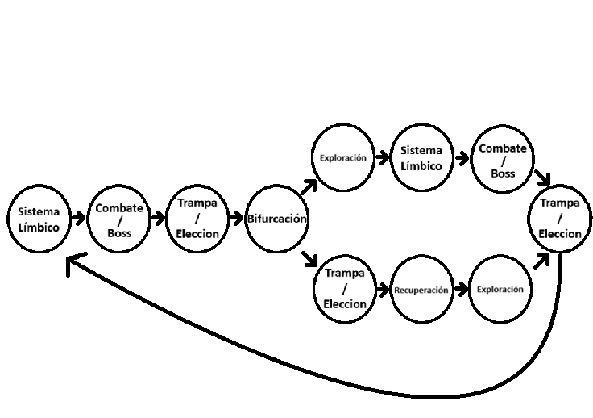

# 6. Interfaz

## 6.1 Cámara

La cámara será fija y en vista lateral.

(Explicar un poco mejor)

## 6.2 HUD Menús

| Salas combates 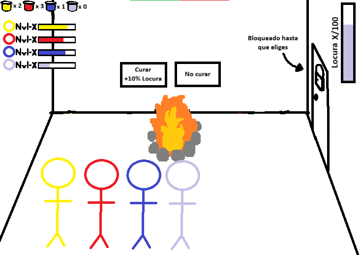 | Salas elección 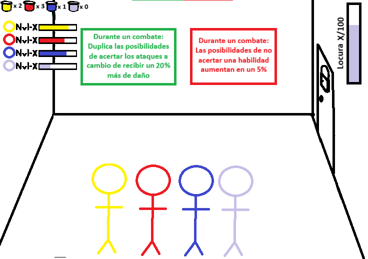 |
| :---- | :---- |
| **Salas trampa** 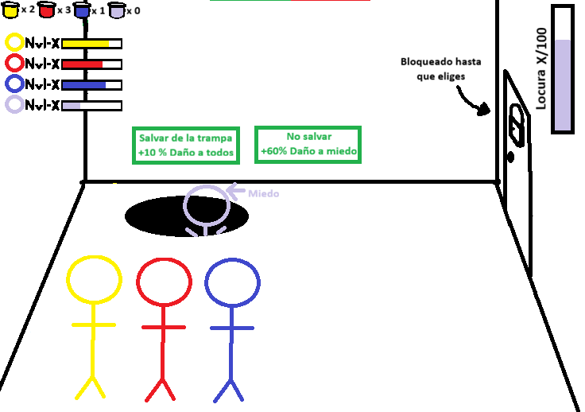 | **Salas de recuperación** 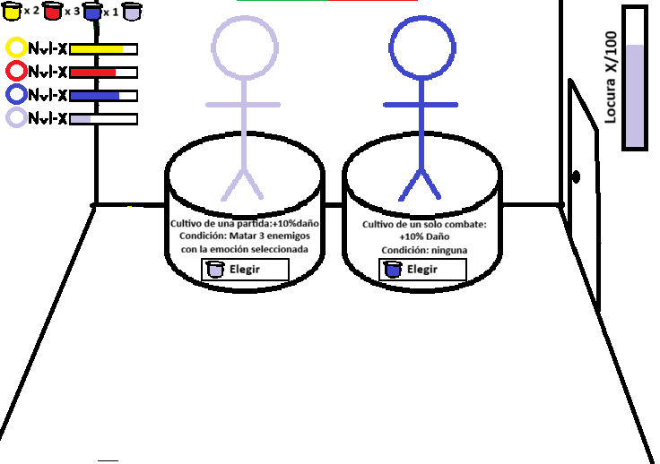 |
| **Salas sistema límbico** 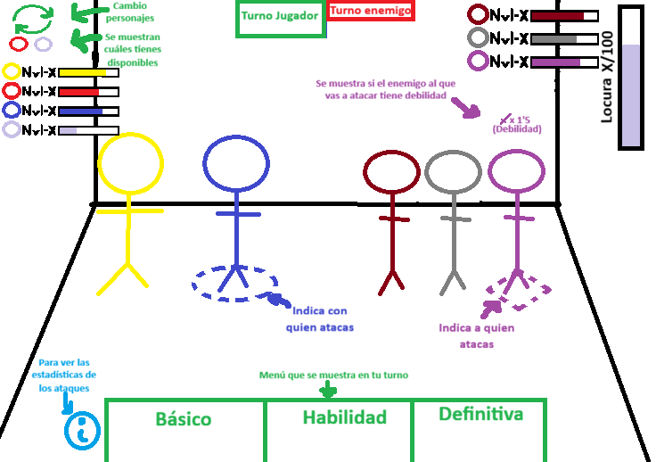 | **Salas bifurcación** 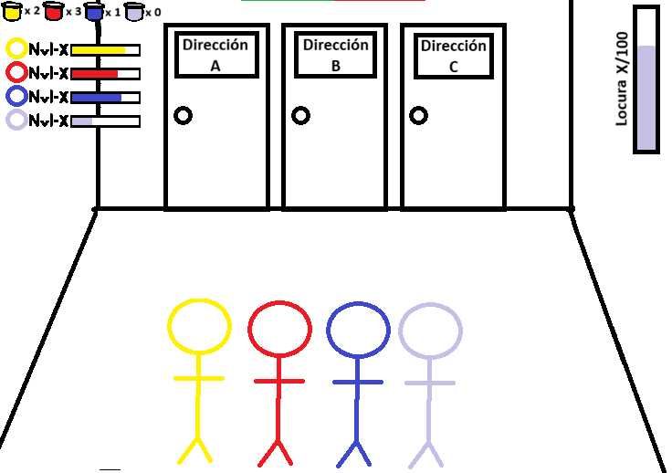 |

# 7. Experiencia de Juego

## 7.1 Trasfondo

Eustaquio es un chaval de 19 años que, por circunstancias de la vida, lleva 12 meses en un estado mental bloqueante. Ha desarrollado un gran **MIEDO** a sentir emociones por el daño que estas le han hecho injustamente desde que era un niño pequeño. Sin embargo, también niega sufrir este rechazo, y se ha convencido a sí mismo de que nada le importa, auto-bloqueando entre otras cosas el acceso a sus propios recuerdos, buenos y malos.

Hay gente que intenta ayudarle, pero nadie ha sido capaz de dar con la clave, excepto él mismo. (para llegar al punto de miedo extremo y encerrona en el que está ahora, ha tenido que pasar por muchas etapas, llegando a desarrollar pequeños ápices y síntomas de diversas enfermedades mentales, que, en el fondo; le mantienen con vida al hacerle dudar de si lo que está haciendo realmente está bien.

No obstante, estas emociones están atrapadas en sus recuerdos, golpeándole de vez en cuando como un bebé golpea la panza de su madre desde dentro)

Cada noche, algo dentro de él despierta para tratar de liberarle de su cárcel: sus propias emociones intentando salir, desadormecidas por el enorme **MIEDO** que él mismo desmiente tener.

## 7.2 Historia

Madrugada del 1 de enero de 1967, Eustaquio ha salido a escondidas de la cena familiar de Nochevieja y se dirige en bici al primer bar del barrio más cercano.

De camino, su cabeza es incapaz de recordar una y otra vez sus traumas familiares, que derivan en sus traumas escolares, que derivan en que empiece a beber sin parar nada más llegar al bar. Sin embargo, esto no evita que sufra de un ataque de ansiedad, que junto con el alcohol, causan que Eustaquio se desmaye en el suelo del bar.

Como irse a dormir, pero con el miedo más presente que nunca, más que en una pesadilla; y, junto a él, como siempre: alegría, tristeza e ira, que, por primera vez, no duermen.

No obstante, no están solos: junto a ellos están todas las enfermedades mentales con las que Eustaquio ha coqueteado mínimamente, destrozando el cerebro por dentro: rompiendo conexiones neuronales, arrancando trozos de las paredes

Al ver esto, deciden recorrer juntos el cerebro de Eustaquio para acabar con todas estas enfermedades, a la vez que intentan recuperarse a ellos mismos así como su relación.

Como consecuencia, Eustaquio irá deshaciéndose de su bloqueo mental.

Con todo, las enfermedades no serán su único problema, ya que a estas se unirán los recuerdos que Eustaquio no es capaz de aceptar.

Según los vayan superando, las emociones irán recuperando su naturaleza real, y el cerebro se irá reconstruyendo solo hasta volver a un estado en el que Eustaquio tendrá que poner su granito de arena, una vez salga de su desmayo.

Así, todos juntos, recuperarán al Eustaquio de verdad.

Migraña con aura: mientras las emociones avanzan por el cerebro de Eustaquio, este está siendo transportado desde el bar en el que se desmaya hasta el hospital más cercano, pasando por los pasillos del hospital; en los que le suben a una camilla, oye gritos, ve luces parpadeantes en el techo, intenta hablar pero no puede

# 8. Dinámicas

Desde el comienzo de la experiencia, el jugador se encuentra en constante exploración y búsqueda de lo desconocido. El hecho de tener distintas elecciones y posibles salas hace que no sepa qué le depara el juego. Durante el juego, el jugador siente que puede intentar conseguir una mejora más o subir un poco más su barra sin morir de locura, lo que le lleva a asumir más riesgos.

A la vez que tiene que gestionar la estrategia para intentar no sufrir mucho daño por los enemigos en combate. También debe gestionar sus mejoras para que se activen. Intentar generar combos y sinergias entre sus personajes.

La experiencia está diseñada para poder rejugarse, por lo que los errores se castigan mucho. Esto hace que el jugador sienta que estuvo cerca, pero no lo suficiente, y que quiera intentarlo de nuevo.

Con todos estos detalles, conseguimos que el jugador permanezca atento a la pantalla durante toda la experiencia para no equivocarse y elegir bien qué va a hacer.

Esto da lugar a una experiencia en la que el jugador se mantiene animado y emocionado durante todas sus partidas. Al ver nuevas mejoras el jugador se verá más poderoso y creerá que puede pasar por encima de los enemigos, pero estos le mantienen al borde de perder.

# 9. Estética

## 9.1 Arte

     **TRISTE(cambiar)               MIEDO                          IRA                       ALEGRÍA**

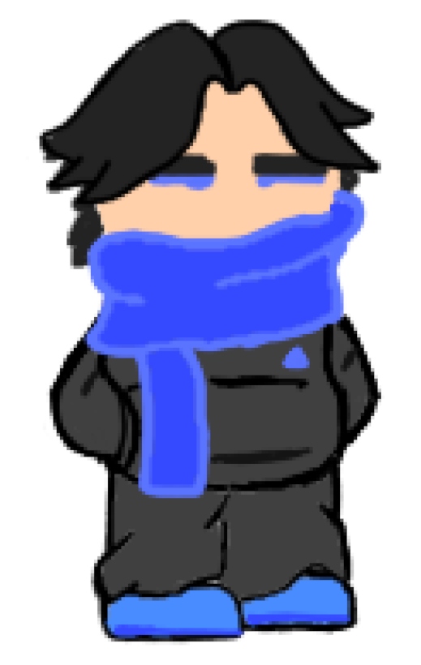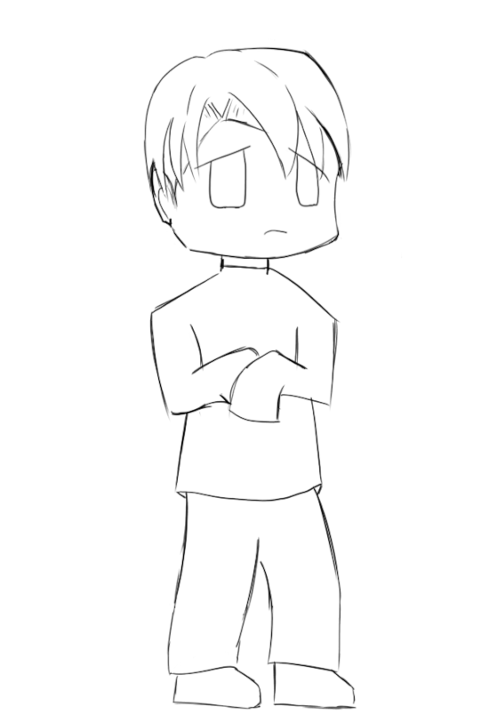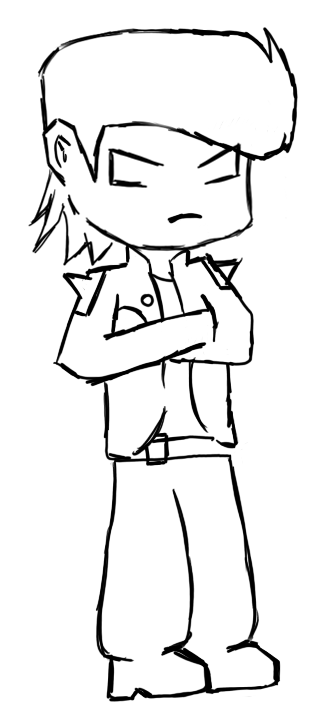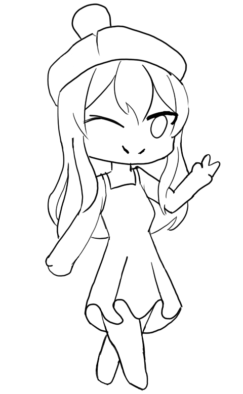

## 9.2 Sonido

# 10. Referencias

**Legend of Keepers([Goblinz Studio](https://www.google.com/search?client=firefox-b-d&hs=MO3V&sca_esv=a6b539e48a8c50fd&sxsrf=APpeQnsKdyRDZkdfna5HM2rzo16PyZ4AuQ:1790664102321&q=Goblinz+Studio&si=APenkKmVGdgpMPDQZoEWS8RIAhsqXAKlNLP0B8DNkkiU9KPI0Rll6DmKnn_znhwu2ouAp3Hdfs6aMs_Kc9z5pociAZ37Oxz4_mveyWMmMgkLjctJgf5X7ZYRKGURqdRez-_ITuBRkWDVQvPcuDfxxnt0zqYsVhKxkAdDwzpO7XiYp9jwbJz9cFS_gQuaythSd1rI1Bznh0fOtr8wdgTlOHyHU6BpbPruIA%3D%3D&sa=X&ved=2ahUKEwio5-vNl5OXAxWThP0HHc5NHcYQmxN6BAgOEAI) , 2020):**

**For The King([IronOak Games](https://www.google.com/search?client=firefox-b-d&hs=PO3V&sca_esv=a6b539e48a8c50fd&biw=1520&bih=896&sxsrf=APpeQnseeHr9yQ51OhwTVAowFNRIP9VcjQ:1790664275141&q=ironoak+games&si=APenkKmVGdgpMPDQZoEWS8RIAhsqXAKlNLP0B8DNkkiU9KPI0ZR-fbVMeFE8PYVND90ZwnT1rhiTTiHc2muU71e-nwZSeP-LUjtOj-7P7gpl87Pw-nKYqWrU6BWB9adOtpUsWRliCvgnYGn6TXgqExePCf6eslRdZa8LZEjd0gxzgxPByLnnD74aZBCXBpP_jsbd6JeAbFzBss3TE_tPIiXYMW0rO0MXNA%3D%3D&sa=X&ved=2ahUKEwjNi6CgmJOXAxXcRP4FHZ7eL8QQmxN6BAgjEAI), 2018):**

**Gloomhaven([Flaming Fowl Studios](https://www.google.com/search?client=firefox-b-d&hs=SO3V&sca_esv=a6b539e48a8c50fd&biw=1520&bih=896&sxsrf=APpeQnus93fgoBfiSbayz-AOW62oJRo5JQ:1790664446421&q=Flaming+Fowl+Studios&si=APenkKmVGdgpMPDQZoEWS8RIAhsqXAKlNLP0B8DNkkiU9KPI0eoVx8KfAb8ocjw3owWMhqO2esDxDPxH0rbjJfNlhoSwiM5s6_BWaVuJW94KjOT_DWFYxiub_jmh-L_dfEM6qc3QwvOiziHwkYHzGl-_ENdeAuITd6qECrI4BXnUzw1gpjvzm_pHTMvm77ITz4lSErVjOVZhje4XPvz9ZKNDMN_6pwaji8yJ_VGk6hEFqEhlvAa2momfHdxf0ItO4lnaWy55qq2JyXbB-1fYCsBvoc-vZDstiWxkesu9hmkoq1hVJbTaqznk39jMDUX1f2_HqQ5x7n4W&sa=X&ved=2ahUKEwiMnPbxmJOXAxW48LsIHaPCLLAQmxN6BAgREAI), [Saber Interactive](https://www.google.com/search?client=firefox-b-d&hs=SO3V&sca_esv=a6b539e48a8c50fd&biw=1520&bih=896&sxsrf=APpeQnus93fgoBfiSbayz-AOW62oJRo5JQ:1790664446421&q=Saber+Interactive&si=APenkKlisoOXLiCMwraINHtdqOQii4CK9kOlkQc8Apn-pS60yXGMHkzeqvf4Rxd8IDD4aevmEGPoVFsOk_GGPlFQ7Ig9riIBUyRSZ69meuxCcbuMK-3ehdNx9OXwCHAqa_gz09PrRGBVG_cvjeUTGiQGwQJTno1_OR1mqBxNeG60h9BG6-rkAwsz0HBKGQKhcVlzQMGY4wX4r9NN7fo3LlehBzWygoCe8OBMUwyHBLyJxyHDOqxTeoRAoHGXwVOO00JkwMt-p7Etfpzzv3M_5J9IqBKVUgX7vKnqMCiRT0X7ALvqkxumI4k%3D&sa=X&ved=2ahUKEwiMnPbxmJOXAxW48LsIHaPCLLAQmxN6BAgREAM), 2019):**

**Hades([Supergiant Games](https://www.google.com/search?client=firefox-b-d&hs=4iiq&sca_esv=a6b539e48a8c50fd&biw=1520&bih=896&sxsrf=APpeQnsQeEM8APjdQRhXSGOYnnwCTWKE9A:1790664356589&q=Supergiant+Games&si=APenkKkicnuBo3HChbgOSg9PTrSKjmOZoDYMZFfiLeKjxtW676Hbbt1uAXplg6l_nDxWVadV7bBf39zuaP-WerHtI2gkvpy2I2WsRRrIft19vsBm9WLmRrFRcLeRqafeaDhllDsR0j7RtY3hHTFR2VT0xENZAmt5x8yxnaOCK7ogyyP4tft4ZK_906KUBN3C4ROlOCo0czhWjDdhJ0_Gibl2AHeEf7HULw%3D%3D&sa=X&ved=2ahUKEwj-nYvHmJOXAxWZgf0HHZCtGPIQmxN6BAgeEAI), 2019):**

**Inside Out(PIXAR, 2015):**
